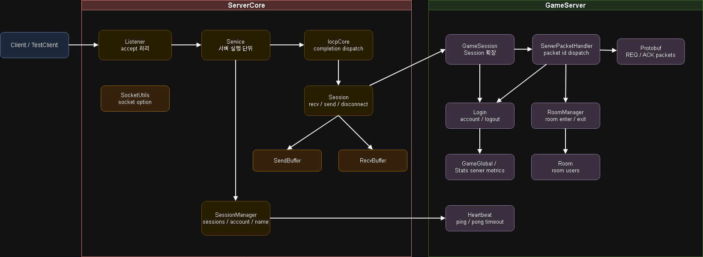

# C++ IOCP Game Server Portfolio

Windows IOCP 기반 비동기 TCP 게임 서버 포트폴리오입니다.

`ServerCore`는 IOCP, 세션, 송수신 버퍼, 스레드, 설정 로딩 등 서버 공통 구조를 담당합니다.  
`GameServer`는 로그인, 룸 입장/퇴장, 룸 채팅, 전체 채팅, 귓속말, heartbeat 기반 연결 상태 관리를 구현합니다.  
`TestClient`는 수동 테스트와 다중 세션 부하 테스트를 지원합니다.

## 특징

- Windows IOCP 기반 비동기 네트워크 처리
- `Session`, `Listener`, `Service`, `SessionManager` 기반 서버 구조
- `RecvBuffer`, `SendBuffer` 기반 패킷 송수신
- Protobuf 기반 패킷 직렬화
- 로그인 / 로그아웃
- 룸 정보 조회 / 룸 입장 / 룸 퇴장
- 룸 채팅 / 전체 채팅 / 귓속말
- Heartbeat ping-pong 기반 timeout disconnect
- Send queue overflow 방어
- Packet size / packet id 검증
- TestClient 수동 테스트 모드
- TestClient 다중 세션 부하 테스트 모드
- 서버 / 클라이언트 통계 출력
- ini 기반 서버/클라이언트 실행 설정 분리 및 값 검증
- 세션 JobQueue를 통한 패킷 처리와 연결 정리 직렬화
- 최대 접속 수 제한 및 정원 초과 안내 후 연결 종료
- JobTimer 기반 Accept 재시도와 부분 송신 처리
- `/q` 및 입력 EOF 기반 서버/클라이언트 정상 종료

## 기술 스택

- C++17 / C++20
- Windows IOCP
- Winsock2
- Protobuf
- Visual Studio 2022
- MySQL ODBC, DB 연동 확장용

## 프로젝트 구조

```txt
Server_Portfolio
├─ Server
│  ├─ GameServer
│  │  ├─ Config
│  │  ├─ Login
│  │  ├─ Main
│  │  ├─ Packet
│  │  ├─ Protobuf
│  │  ├─ Room
│  │  ├─ Struct_info
│  │  └─ Utils
│  └─ ServerCore
│     ├─ DB
│     ├─ Job
│     ├─ NetWork
│     ├─ Thread
│     └─ Utils
└─ TestClient
   └─ TestClient
      ├─ Buffer
      ├─ Config
      ├─ Main
      ├─ NetWork
      ├─ Packet
      ├─ Protocol
      ├─ Session
      └─ Utils
```



## 구조

### ServerCore

`ServerCore`는 서버에서 공통으로 사용하는 네트워크, 스레드, 작업 큐, 설정 로딩, DB 연결 기반 구조를 담당합니다.

- `IocpCore`: IOCP handle 관리 및 completion dispatch
- `Listener`: client accept 처리
- `Service`: 서버 실행 단위
- `Session`: socket, recv, send, disconnect 처리
- `SessionManager`: 접속 세션, 로그인 세션, 닉네임 세션 관리
- `RecvBuffer`: 수신 버퍼 관리
- `SendBuffer`: 송신 버퍼 관리
- `SocketUtils`: socket 생성 및 option 설정
- `JobQueue`, `GlobalQueue`, `JobTimer`: 예약 작업 및 비동기 작업 처리 기반
- `ConfigReader`: ini 설정 파일 로딩

### GameServer

`GameServer`는 실제 게임 서버 로직을 담당합니다.

- `GameSession`: 클라이언트 세션 확장
- `Login`: 계정 생성, 로그인, 로그아웃 관리
- `Room`, `RoomManager` : 룸 생성, 입장, 퇴장, 룸 유저 관리
- `ServerPacketHandler`: 패킷 분배 및 처리
- `GameGlobal`: 서버 전역 객체 및 통계 관리
- `Protobuf`: 클라이언트/서버 패킷 구조

### TestClient

`TestClient`는 서버 검증을 위한 클라이언트입니다.

- `Manual Mode`: 직접 로그인, 룸 조회/입장/퇴장, 채팅 입력
- `Load Test Mode`: 다수 봇 세션 생성 및 부하 테스트
- 클라이언트 송수신 통계 출력
- IOCP 기반 비동기 recv / send 처리

## Packet 흐름

상세 패킷 흐름은 [docs/packet-flow.md](docs/packet-flow.md)에 정리했습니다.

요약:

- Login: `REQ_LOGIN / REQ_BOT_LOGIN` 요청을 검증하고 `ACK_LOGIN / ACK_BOT_LOGIN`으로 결과를 응답합니다.
- Room: 룸 목록 조회, 입장, 퇴장 요청을 `RoomManager`에서 처리합니다.
- Chat: 요청 결과(`ACK_CHAT`)와 실제 메시지 전달(`ACK_SEND_CHAT`)을 분리합니다.
- Heartbeat: 서버가 ping을 보내고 클라이언트 pong 응답으로 연결 생존 여부를 확인합니다.


## Reliability

상세 안정성 보강 내용은 [docs/reliability.md](docs/reliability.md)에 정리했습니다.

주요 방어 로직:

- packet size / packet id 검증
- Protobuf parse 실패 처리
- 로그인 전 요청 제한
- 룸 입장 상태 검증
- 채팅 message 길이 검증
- send queue 누적 제한
- disconnect 중복 처리 방지
- heartbeat timeout disconnect


## Config

실행 설정은 `config.ini`로 분리합니다. 실제 로컬 설정 파일은 Git에 포함하지 않고, 예시 파일만 커밋합니다.

```txt
config.example.ini  # Git에 포함
config.ini          # 로컬 실행용, Git 제외
```

### GameServer Config

`Server/GameServer/Config/config.example.ini`

```ini
[server]
ip=127.0.0.1
port=7777
work_thread_count=4
session_max_count=2000

[database_info]
driver=MySQL ODBC 9.0 Unicode Driver
ip=localhost
database=2drpg
user=CHANGE_ME
password=CHANGE_ME
```

### TestClient Config

`TestClient/TestClient/Config/config.example.ini`

```ini
[client]
session_count=1000
bot_thread_count=4
worker_thread_count=4
chat_interval_ms=2500
bot_room_count=10
all_chat_interval=10
whisper_interval=15

[server]
ip=127.0.0.1
port=7777
```

## 작동 방식

### 1. Clone

```bash
git clone https://github.com/GodDongjin/Server_Portfolio.git
cd Server_Portfolio
```

### 2. 로컬 설정 파일 생성

예시 설정 파일을 복사해 로컬 실행 설정을 만듭니다.

```bash
copy Server\GameServer\Config\config.example.ini Server\GameServer\Config\config.ini
copy TestClient\TestClient\Config\config.example.ini TestClient\TestClient\Config\config.ini
```

필요하면 `ip`, `port`, `session_count`, `worker_thread_count` 등을 로컬 환경에 맞게 수정합니다.

### 3. GameServer 실행

Visual Studio 2022에서 다음 솔루션을 엽니다.

```txt
Server/GameServer.sln
```

`GameServer` 프로젝트를 `Debug x64` 또는 `Release x64`로 실행합니다.

### 4. TestClient 실행

Visual Studio 2022에서 다음 솔루션을 엽니다.

```txt
TestClient/TestClient.sln
```

실행 후 테스트 모드를 선택합니다.

```txt
1. Manual Test
2. Load Test
```

Manual Mode 명령:

```txt
/rooms                      방 목록 조회
/enter [room_id]            방 입장
/exit                       방 퇴장
/chat [message]             현재 입장한 방에 채팅 전송
/all [message]              전체 채팅 전송
/whisper [name] [message]   귓속말 전송
/q                          로그아웃 후 종료
```

Load Mode에서도 `/q` 또는 입력 종료로 테스트를 끝낼 수 있습니다.
봇 작업을 멈추고 연결을 닫은 뒤, 취소된 송수신의 완료 통지까지 처리하고 IOCP 스레드를 종료합니다.
수동 로그인 입력과 재입력은 메인 스레드에서 처리하므로 입력 대기 중에도 핑에 응답합니다.

클라이언트 설정은 연결 전에 검사합니다. 포트는 1~65,535, 세션 수는 1~100,000,
IOCP·봇 스레드 수는 각각 1~256, 채팅 주기는 1~60,000ms, 봇 방 수는 1~256입니다.
전체 채팅·귓속말 간격은 양의 정수여야 하며 숫자 뒤의 불필요한 문자도 오류로 처리합니다.
`bot_room_count`는 실제 서버의 방 구성에 맞추어 설정해야 합니다.

## 패킷 코드 재생성

일반적인 C++ 빌드에는 Python이 필요하지 않습니다. `.proto` 또는 패킷 핸들러 템플릿을
수정할 때만 Python 3.10 이상과 아래 의존성을 설치합니다. 다음 명령은 저장소 루트 기준입니다.

```powershell
python -m pip install -r Server/Tool/PacketGenerator/requirements.txt
python Server/Tool/PacketGenerator/PacketGenerator.py --target all
```

- `--target server`, `--target client`: 한쪽 코드만 재생성합니다.
- `--check`: 파일을 수정하지 않고 현재 생성 코드와 일치하는지 검사합니다. 다르면 종료 코드 1을 반환합니다.
- 기존 `Server/Common/protoc-21.12-win64/bin/GenPackets.bat`과
  `TestClient/Common/protoc-28.1-win64/bin/protocol.bat`도 같은 Python 도구를 실행합니다.

서버와 클라이언트의 `.proto`는 각각 `Server/Common/protoc-21.12-win64/bin`과
`TestClient/Common/protoc-28.1-win64/bin`에 있습니다. 프로토콜을 변경할 때 두 곳을 함께 수정합니다.
두 폴더의 `protoc.exe`는 모두 21.12 버전이며, 클라이언트 폴더의 `28.1`은 기존 디렉터리 이름입니다.

핸들러 템플릿은 `Server/Tool/PacketGenerator/Templates`에서 관리합니다.
서버 템플릿에는 세션 JobQueue 처리, 클라이언트 템플릿에는 수신 패킷과 송신 크기 검사가 포함됩니다.
생성 대상 전체를 임시 디렉터리에서 먼저 생성하므로, 생성에 실패하면 프로젝트 파일은 갱신하지 않습니다.
도구가 스크립트 위치를 기준으로 경로를 찾기 때문에 실행 디렉터리에 영향을 받지 않습니다.

## 기능 검증

- [서버 테스트](Server/Tests/README.md): 세션 작업 큐, Accept 재시도, 송수신 실패,
  로그인/재접속, 채팅 대상 수, 정원 초과, 정상 종료를 검증합니다.
- [테스트 클라이언트 테스트](TestClient/Tests/README.md): 부분 송신, 패킷 크기 제한,
  설정 검증, 수동/부하 모드 종료와 연결 정리를 검증합니다.

## 부하 테스트

TestClient의 Load Test Mode를 사용해 1,000개 클라이언트 세션을 생성하고, 룸 채팅/전체 채팅/귓속말이 섞인 채팅 송수신 부하를 측정했습니다.

### Test 환경

```txt
Build: Release x64
Server: GameServer
Client: TestClient Load Test Mode
Protocol: TCP / IOCP
Serialization: Protobuf
Client Count: 1,000
Chat Interval: 2,500ms
```

### 결과

### Debug x64 결과

Debug x64 환경에서는 TestClient 1,000개 세션과 수동 접속 1개를 포함해 총 1,001개 세션으로 테스트했습니다

| Item | Result |
|---|---:|
| Build | Debug x64 |
| Connected Sessions | 1,001 |
| Login Success | 1,001 |
| Chat Interval | 2,500ms |
| Total Broadcast Target | 3,411,262 |
| Client Total Recv | 3,411,262 |
| Backlog | 0으로 회복 / 누적 없음 |
| Disconnect | 1001 정상 종료 |

### Release x64 결과

Release x64 환경에서는 TestClient 1,000개 세션으로 테스트했습니다.

| Item | Result |
|---|---:|
| Connected Sessions | 1,000 |
| Login Success | 1,000 |
| Chat Interval | 2,500ms |
| Total Broadcast Target | 7,131,488 |
| Client Total Recv | 7,131,488 |
| Backlog | 0으로 회복 / 누적 없음 |
| Disconnect | 1,000 정상 종료 |

### 부하 테스트 요약

| Clients | 채팅 간격 | 예상 브로드캐스트 처리량 | 결과 |
|---:|---:|---:|---|
| 1,000 | 5000ms | 약 200K/sec | Stable |
| 1,000 | 3000ms | 약 333K/sec | Stable |
| 1,000 | 2500ms | 약 400K/sec | Stable |
| 1,000 | 2000ms | 약 500K/sec | Backlog Increasing |

### 통계 예시

Client:

```txt
[CLIENT] connect = 1,000 login = 1,000 send = 6,321 recv = 6,264,142 disconnect = 0 send/s = 0 recv/s = 466,323 backlog = 0
```

Server:

```txt
[SERVER] connect = 1,000 login = 1,000 recv_chat = 6,321 broadcast_target = 6,321,000 disconnect = 0
```

## 현재 제한 사항

- 계정 정보는 현재 DB가 아닌 메모리 기반으로 관리됩니다.
- DB 연결 코드는 확장용으로 분리되어 있으며, 현재 로그인 로직에는 연결하지 않았습니다.
- 부하 테스트는 단일 PC 환경 기준입니다.
- Room 생성/삭제 정책은 현재 고정 설정 기반이며, 동적 확장은 향후 개선 항목입니다.

## 다음 개선 사항

- DB 기반 계정 저장
- room 생성/삭제 정책 개선
- JobQueue 기반 room broadcast 최적화
- 운영 로그/에러 로그 정리
- 장시간 soak test 추가


## 서버 정상 종료

서버 콘솔에 `/q`를 입력하면 새 Accept와 재시도를 중단하고, 접속 중인 세션 및
정원 초과 안내를 송신하던 임시 세션의 소켓을 닫습니다. IOCP 작업 스레드는
취소된 IO 완료 통지와 세션 JobQueue의 방 퇴장·로그아웃·등록 해제를 처리한 뒤 종료합니다.
하트비트와 통계 스레드의 대기는 종료 신호로 깨우며, 최종 누적 통계는 콘솔에 표시합니다.

표준 입력 EOF도 같은 종료 경로를 사용합니다. 자동 실행에서는 입력 파이프를 열어 두고
종료할 때 `/q` 또는 EOF를 전달합니다. 콘솔 창 강제 닫기·프로세스 강제 종료는
이 절차의 대상이 아니며, 종료 직전 채팅의 상대방 수신까지 보장하지 않습니다.

```powershell
python Server/Tests/server_shutdown_test.py Server/Binaries/Release/GameServer.exe --client TestClient/x64/Release/TestClient.exe
```

빈 서버의 `/q`·EOF, 단일 작업 스레드에서 연결 정리, 정원 초과 및 접속 시도와
종료의 경합, 실제 테스트 클라이언트 1,000명 접속 중 종료를 검사합니다.
임시 설정과 별도 loopback 포트를 사용하며 기존 실행 중인 서버에는 접속하지 않습니다.
